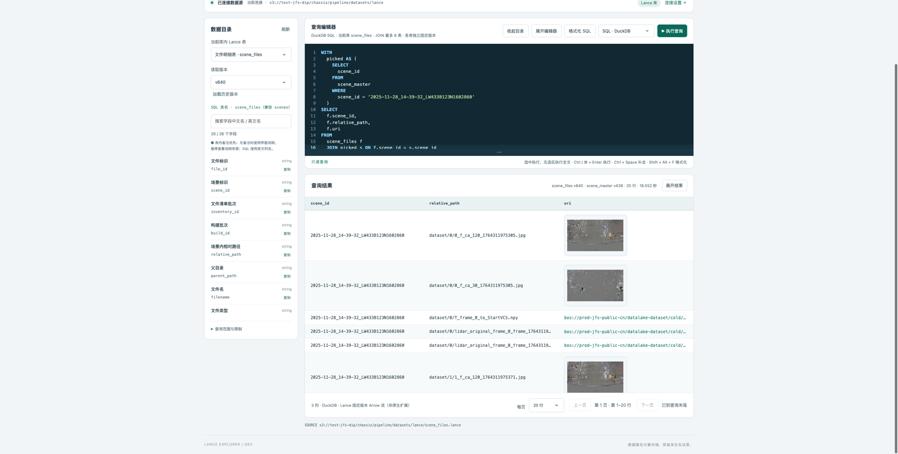
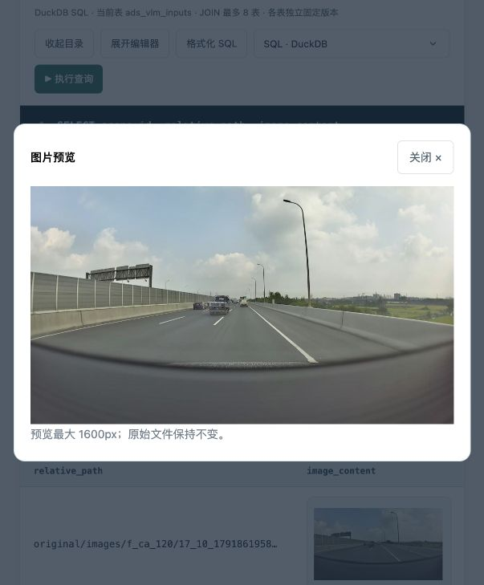
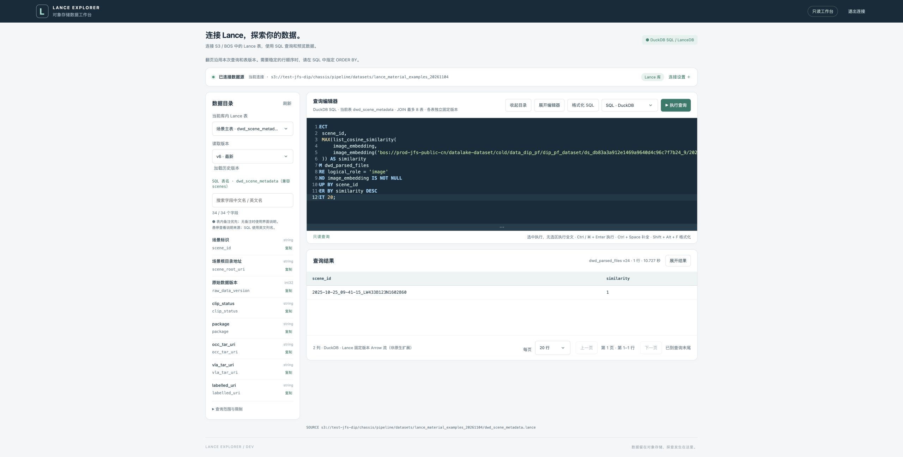
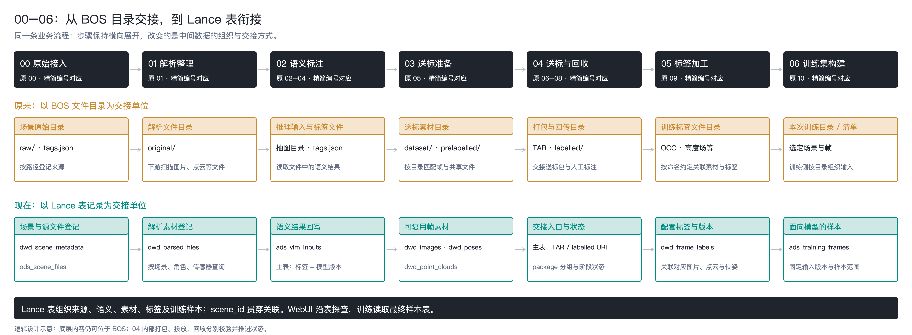

在多模态训练链路里，我们每天处理图片、点云、位姿、标定、人工标注，以及加工后的 OCC、高度场和训练 tensor。

这些数据通常已经在对象存储里，也有一套能够运转的处理脚本。但随着场景数量和使用需求增加，问题逐渐集中到几件事上：我们到底有哪些数据？某张图片对应哪份点云、标定和标签？能否直接找到需要的场景？同一批素材能否服务不同训练任务？

基于 Lance 的这次实践，就是从这些问题出发。我们希望将多模态数据组织成可以查询、关联和持续补充的表，再通过 WebUI 探查数据，通过作业加工数据，最后交付给训练。

## 数据已经存下来了，但使用仍然依赖目录

原有流程以文件为中心：上游将产物写入 BOS 目录，下游根据目录结构和文件名寻找输入，解析后再生成下一批文件。训练需要哪批数据，就准备相应的场景清单和数据目录。

这种方式在单个任务里很直接。问题在于，数据关系往往散落在代码约定里：图片与点云如何配对、一个场景共用哪份标定、哪批标签由哪个版本生成，都需要沿着脚本和目录追溯。

当需求变成“找一批下雪场景，要求图片、点云和某个版本的标签齐全”时，往往又要写一次扫描脚本、整理一次路径清单。人想抽查几帧，也需要下载文件或准备专门的读取程序。

我们希望让这些关系成为数据本身的一部分。上下游的交接方式由此发生变化：

```text
上游写目录 → 下游扫描目录、匹配文件名 → 加工
                         ↓
上游发布表记录 → 下游查询明确的输入 → 读取内容或文件 → 加工
```

对象存储仍然承载底层数据。表负责表达数据是什么、彼此如何关联，以及下游应该读取哪些记录。

## 先沉淀共享素材，再构建具体数据集

建模时，我们首先确定“一行代表什么”和“谁会消费它”，再决定如何划分表。

从逻辑上看，这套数据可以分成三个层次：

| 层次 | 组织的内容 | 主要用途 |
| --- | --- | --- |
| 场景与来源 | 场景身份、来源、语义标签、原始素材清单 | 找场景、明确来源、关联素材 |
| 可复用素材与加工产物 | 图片、点云、位姿、共享标定，以及指定版本的标签 | 跨步骤复用、继续加工、数据探查 |
| 面向任务的数据集 | 按选数条件、标签版本和模型输入要求组织的样本 | 训练、评估或其他下游消费 |

这是逻辑划分，不限定最终必须有几张物理表。按消费方式，可以把经常共同使用的信息放在一起，也可以把一场景共享的标定放在素材主记录中，让各帧通过业务键引用。

这里最关键的选择是：**将持续积累的素材，与某一次需求加工出的数据集分开。**

一批图片、点云完成解析后，可以先用于 VLM 分析和送标。人工标注回收后，再补充对应的标签与版本。后续需要另一个训练集时，继续从这批素材选择和加工，不必因为使用目的改变就重新执行所有上游步骤。

例如，需要下雪场景的训练数据，可以按下面的路径组织：

```text
按语义标签筛选场景
        ↓
关联图片、点云、位姿与共享标定
        ↓
选择标签版本，检查所需素材是否齐全
        ↓
按模型输入要求加工，形成训练样本表
        ↓
训练 Dataset 读取
```

“下雪”是说明设计的例子，并不代表本文已经完成这一条件下的全流程验收。它体现的是：选数条件可以变化，共享素材继续积累。

## WebUI：让数据能够被人直接探查

表组织好了，还需要让使用者方便地理解和检查数据。因此，我们同时建设了 Lance Explorer，作为面向人的只读数据探查入口。

在 WebUI 中，使用者可以查看表与字段、选择读取版本、执行 SQL，并从查询结果进入多模态内容预览。这样，数据工程师和算法同学可以围绕同一批记录讨论问题。

### 从查询结果找到真实内容

下面是此前验收中的 SQL 关联查询。场景主表筛选出场景后，通过 `scene_id` 关联文件明细，返回文件路径和 URI。对于能够识别并访问的图片结果，页面展示缩略图。



*图 1：2026-11-06 的真实验收截图。左侧查看字段与版本，中间执行 SQL，下方查看记录和图片缩略图。截图包含早期字段，不代表最终建模要求。*

这使得探查可以从业务条件开始：先确定关心的场景，再检查该场景有哪些素材，最后打开具体内容。路径、结构化字段和视觉内容出现在同一个工作流里。

### 从图片预览检查实际内容

对于图片，仅看到 URI 很难判断数据是否符合需求。直接打开预览，可以更快发现画面内容、遮挡和明显异常，也便于核对 VLM 标签是否合理。



*图 2：2026-11-05 的图片预览验收截图，从查询结果打开实际图片。*

数据探查还可以帮助定位流水线问题。例如，一条记录已经存在，但内容不可访问，需要检查地址与权限；图片存在但标签缺失，则需要检查标签加工状态。WebUI 将这些线索展示出来，具体质量规则和完整性校验仍需由我们实现。

## 从标签选数，进一步走向相似内容查找

结构化字段适合表达已经明确的条件，例如天气、道路类型和标签版本。但使用者有时只有一张参考图片，希望找到相似画面及其所属场景。

为此，我们也做了图片 embedding 与相似度查询的原型验证：将图片特征与对应记录关联，计算参考图片和候选图片的相似度，再通过场景键组织结果。



*图 3：2026-11-06 的图片相似度 SQL 原型截图。当次只有一条结果，相似度为 1；它说明查询链路已被执行，不能据此评价大规模检索效果、召回率或性能。该示例也不证明已经使用 Lance 向量索引加速。*

这与 VLM 标签形成两种互补的探查入口：知道条件时按字段筛选，只有视觉参照时按内容查找。找到候选后，再检查图片和关联素材，决定是否用于后续加工。

embedding 模型、语义标签与人工标注都会演进。因此，它们需要记录各自的来源和版本，避免将不同模型或不同标注批次的结果混用。

## 让流水线围绕表衔接

表把流水线串起来的方式，是让每个作业**从表中确定输入，处理后将可复用结果发布回表**。下一步根据记录和业务关联键取得所需数据，输入范围与产物关系由表明确表达。

我们将原 00–10 精简展示为 00–06 七个步骤，横向排列：原始接入 → 解析整理 → 语义标注 → 送标准备 → 送标与回收 → 标签加工 → 训练集构建。图中上下两行对比每一步产物的组织方式。



*图 4：同一条业务流程，原来通过 BOS 目录和文件清单交接；现在通过 Lance 表记录明确输入、关联产物并支撑下游消费。00–06 是本文精简展示编号，各框内保留原步骤对应关系；不表示平台作业已经重新编号。图为目标逻辑设计，不代表整条生产链路已经完成验收。*

原方式下，下一步根据目录、文件名和清单取得输入。改用表组织后，下一步可以查询上游产物记录，再按场景、帧及标签版本关联需要的数据。底层内容仍可存放在 BOS，变化的是中间数据的组织与交接方式。

**首先，解析结果成为后续步骤共享的素材。** 原始数据接入时登记场景和源文件；解析作业据此取得输入，再把图片、点云、位姿等结果发布到素材表。不同模态通过场景、素材包、帧及传感器等业务键关联，共享标定也有明确引用。之后的 VLM、送标和训练集构建，可以复用这些解析结果。

**其次，加工结果回到已有数据关系中。** VLM 读取图片后，将语义标签及模型版本关联回场景或图片记录。选帧作业据此找到目标场景，再关联素材准备送标。人工标注回收后，登记标注与版本，并将后续生成的 OCC、高度场等产物与对应帧关联。新的加工持续丰富同一批素材，供后续查询和使用。

**最后，数据集构建作业从共享素材中组织一次训练的输入。** 它按选数条件确定场景范围，关联所需模态，选择匹配的标签版本，并检查帧对应关系和数据完整性，再输出面向模型的训练宽表。需要另一批场景或另一版标签时，可以从共享素材重新构建；某次送标或训练任务不会决定素材只能用于这一次需求。

WebUI 则提供贯穿这些表的人工探查入口：查看场景有哪些素材、标签是否已经回收、训练样本引用了哪版产物，并打开对应内容抽查。加工程序和使用者围绕相互关联的数据记录工作，更容易核对输入、理解结果和定位缺失。

落地时，优先将跨步骤交接、跨任务复用或需要探查的数据发布到表。已有算法若要求本地目录，可以由适配层按表记录准备输入，再将算法产物登记回表。外部文件仍需保证地址可访问；涉及多张表的阶段，也需在产物校验齐全后再标记完成。

## 训练集需要明确“用了什么”

面向训练时，我们关心的不只是某张表在哪里，还包括本次实验究竟选用了哪些样本。

一份可追溯的数据集定义，至少应明确源表及其版本、选数条件、标签版本、样本加工规则，以及训练和评估的成员清单。多表参与构建时，需要记录各张输入表的对应版本。

Lance 原生提供数据集版本访问能力，可以固定读取某个保留的历史版本。[官方版本说明](https://lance.org/quickstart/versioning/)

但训练复现还涉及表以外的部分：外部 URI 指向的对象是否发生变化、预处理代码是否相同、训练评估是否存在场景交叉，都需要另外约束。表版本、原始数据格式版本与标签版本也应分别记录，不能用一个数字替代全部含义。

在消费端，具体任务可以使用加工后的训练宽表，将一份样本需要共同使用的数据组织在一起。训练代码按照约定恢复 tensor，执行训练时的数据增强，并送入模型。通用素材与任务样本由此承担不同职责。

## 读取实验：从存下数据，到准备好模型输入

表能够查询和复用之后，还需要回答一个直接的问题：实际读取是否高效？我们围绕数据表示和训练消费路径做了几组实验。

这里的核心指标是**从开始读取，到 CPU 侧 batch 拼接完成、可以交给模型的总耗时**，包括必要的解码、预处理、数组恢复和 batch 拼接。它比单独统计读取接口耗时更贴近训练需求，但仍不包含 GPU 前向、反向与参数更新。

### 线上 DIP 作业：比较不同数据表示的完整加载成本

读取对照采用线上 DIP 作业的实测结果：生产空间 `dip-pf`，共享资源池“离线-K8s-Max”，Spark 3.3.2，单 Executor 4 核、30 GiB 内存，另配 12 GiB memoryOverhead。各方案沿用相同环境镜像与依赖包，从 BOS 读取原始文件或 Lance 数据。

测试使用同一批 8 帧，batch=8，每种方案执行 5 轮，每轮使用独立读取进程。下表展示各方案总耗时中位数对应的一轮，各阶段均来自该轮，单位为秒。

| 阶段 | 原 BOS 文件 | Lance：全 tensor | Lance：缩小类型 tensor | Lance：图片 tensor＋稀疏 OCC | Lance：JPEG＋稀疏 OCC | Lance：无损压缩 tensor |
| --- | ---: | ---: | ---: | ---: | ---: | ---: |
| 读取／取数等待 | 4.87 | 5.23 | 3.80 | 0.33 | 0.43 | 0.21 |
| 样本准备 | 8.37 | 1.03 | 1.04 | 4.43 | 6.34 | 2.03 |
| batch 拼接 | 0.46 | 0.42 | 0.33 | 0.37 | 0.26 | 0.26 |
| 其他及舍入差 | 0.52 | 0.18 | 0.10 | 0.05 | 0.01 | 0.01 |
| **完整加载总耗时** | **14.22** | **6.86** | **5.27** | **5.18** | **7.04** | **2.51** |

*前五种方案来自 2026-11-11 的线上复测，压缩方案来自 2026-11-12 同资源池、同配置测试，属于跨日期对照。结果是各方案的代表轮次，不是五轮均值；这里的取数等待也不等于独立测量的纯网络传输时间。*

这组实验比较的是从读取到模型输入就绪的完整路径。全 tensor 方案减少了运行时准备工作；JPEG 与稀疏 OCC 保持较紧凑的表示，但需要在读取后解码和恢复；压缩 tensor 则增加解压与还原工作，以减少读取成本。应结合这些环节的总耗时选择数据表示。

压缩方案五轮总耗时为 2.40～2.59 秒，完整 8 帧及拼接后的 batch 校验通过，五轮输出精确一致。按表中代表轮次计算，其输入准备耗时比 BOS 路径低约 **82.3%**；这是小批加载对照的观察值，不是完整训练加速结论。

这一轮采用应用层 tensor 编码／压缩及读取恢复路径，解压、图片字典还原和 dtype 恢复均计入样本准备。它与后文 11 月 23 日采用 Lance 原生 Zstd 的增列实验属于不同实现，结果应分别解释。

该次连接初始化与输出哈希校验在加载计时之外；成功测量还发生过从临时 STS 到作业运行时凭证的认证回退，因此这组耗时也不覆盖凭证获取与续期的成本。

### 放进真实训练：输入准备更快，训练循环是否随之提速？

我们进一步分析了两次 BOS 与 Lance 训练运行的日志。单样本准备时间有所下降，但训练与验证呈现不同情况：

| 指标 | BOS 运行 | Lance 运行 |
| --- | ---: | ---: |
| 训练单样本完整准备 | 1025.46 ms | 424.55 ms |
| 训练主线程每 batch 等待 DataLoader | 0.44 ms | 0.20 ms |
| 训练每 batch 完整循环 | 1025.72 ms | 1037.85 ms |
| 验证主线程每 batch 等待 DataLoader | 687.64 ms | 418.96 ms |
| 验证每 batch 完整循环 | 1088.14 ms | 801.81 ms |

*以上为 2026-11-20 日志对比报告中的加权均值。两次运行的数据规模不同，资源、缓存与增强配置未完全对齐，属于实际运行观察，尚非受控加速实验。*

训练阶段，后台加载与模型计算重叠，主线程原本就几乎不等待数据。单样本准备更快，并没有在这两次运行中表现为训练单 batch 加速。后台样本准备耗时不能直接加到主线程循环上。

验证阶段仍有明显取数等待，Lance 运行中观察到等待减少，单 batch 循环耗时降低约 **26.3%**。由于两次运行的条件尚未完全对齐，这一差异仍需受控实验确认。

这些测试给出了两个层面的证据：合理的数据表示与预加工路径能够改善输入准备效率；最终训练收益则取决于供数是否位于当前关键路径。训练供数已被后台加载覆盖时，继续优化读取所能带来的单步收益可能有限，需要结合模型计算、通信与后处理继续分析。

## Lance 的存储能力，如何支撑这套设计

随着素材持续补充，我们会增加标签、embedding 和新的训练字段。Lance 的数据演进机制支持追加、回填列；其列文件组织使得新增列可以不重写已有数据文件。这为持续丰富已有素材提供了底层支持。[官方数据演进说明](https://lance.org/guide/data_evolution/)

业务上如何关联图片与点云、如何管理标签、怎样做 SQL 查询、如何在页面渲染内容，则属于我们在 Lance 之上建设的能力。本文中的 WebUI 由我们实现；SQL 使用了 DuckDB 等查询组件，不能将完整工作台都归为 Lance 原生功能。

近期的 tensor 增列实验是一个具体例子。我们在已有训练表上新增了 13 个二进制表示列，使用 `shape`、`dtype` 和 `data` 描述 tensor，并使用 Lance 原生 Zstd 压缩。作业并行写分片，由 Driver 统一提交新版本，随后执行读回校验。

该次实验覆盖 4,223 帧、54,899 个 tensor，提交后全量字节校验通过。平台总耗时为 12 分 15 秒，新增文件约 33.93 GB。这些数字仅对应当次数据与资源配置；原列和原文件仍保留，不能将新增文件大小当作整张表的最终占用，也不能据此推导完整 GPU 训练的提速比例。

这个实验验证了在现有数据上增加消费表示的一条工程路径。本文更关注的收益，则是同一批素材能够不断补充信息，并被不同下游重新选择和使用。

## 从局部验证走向完整闭环

目前的实践已经积累了表查询、图片预览、图片相似度原型、输入准备效率对照、真实训练日志分析，以及训练 tensor 增列和完整性校验等证据。它们对应不同日期、数据和验证范围，尚不能拼接成“整套生产流水线已全部完成”的结论。

完整闭环还需要继续验证跨阶段交接、失败重试、标签版本一致性、多表完整性，以及长期运行时的权限和数据生命周期管理。

我们希望最终形成这样的使用过程：使用者在 WebUI 中找到并检查数据，确认选数规则；作业从共享素材中构建数据集；训练读取明确版本的样本；新产生的标签和特征继续回到可复用的数据体系中。

这使图片、点云和标签逐步成为可以理解、查询、组合与交付的数据资产，也让每次数据加工能够为下一次需求留下可继续使用的成果。
